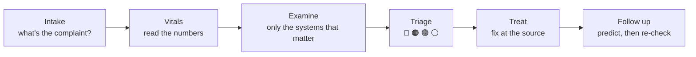
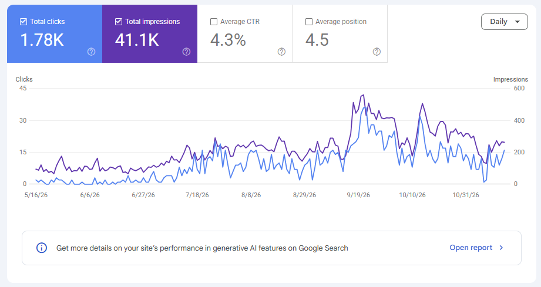

<p align="center">
  
</p>

<h1 align="center">Larrey: SEO & AI Search Audit Skill for Claude Code and AI Agents</h1>

<p align="center">
  <strong>Treat your website like a patient. Examine seven systems. Fix what's costing you most, first.</strong>
</p>

<p align="center">
  <a href="LICENSE"></a>
  
  
  
</p>

---

Larrey is an open-source **SEO audit skill** for AI agents. Point it at a URL, a website repo, or both. Your agent runs a structured check-up across keyword research, on-page, technical SEO, content, off-page, analytics and **AI search visibility** (ChatGPT, Claude, Perplexity, Google AI Overviews). It returns a triaged report with evidence for every finding, and in a codebase it can fix what it finds at the source.

## Why "Larrey"?

In the 1790s, Dominique-Jean Larrey, surgeon-in-chief of Napoleon's army, set a rule that became triage: treat the most dangerously wounded first, **without regard to rank**.

That's the whole idea. Every website has fifty things wrong. Most audits hand you all fifty in a spreadsheet. Larrey finds the three that matter and puts them at the top.

## How it works



### Seven systems, 44 checks

The seven systems and most of their questions are adapted from an SEO map carousel by [@lawrenceaiseo](https://www.instagram.com/lawrenceaiseo/) on Instagram. Larrey turns each question into a test, so the agent gathers evidence instead of reciting a checklist.

| System           | The question it answers                                       | Checks |
| ---------------- | ------------------------------------------------------------- | ------ |
| Keyword research | What is our audience actually typing, and is it worth a page? | 6      |
| On-page          | Does this page answer the question in its first sentence?     | 7      |
| Technical        | Can a crawler, and an AI assistant, actually read this?       | 7      |
| Content          | What does this page say that no other page says?              | 6      |
| Off-page         | Who else says we exist?                                       | 6      |
| Analytics        | What did we change, and what moved because of it?             | 6      |
| AI search        | Are we found and recommended by assistants?                   | 6      |

### Triage levels

|    | Level    | Meaning                                                     |
| -- | -------- | ----------------------------------------------------------- |
| 🔴 | Critical | Stops pages being crawled, indexed or read                  |
| 🟠 | Urgent   | Costing clicks or AI citations right now                    |
| 🟢 | Routine  | Worth doing; schedule it                                    |
| ⚪ | Untested | Needed data the agent didn't have, and what would unlock it |

## What makes it different

- **Audits the source code, not just the page.** In a repo, Larrey checks rendering modes, finds where titles and JSON-LD are generated, and uses `git log` to match traffic drops to deploys.
- **Evidence or nothing.** Every finding cites a URL, a `file:line`, an HTML snippet, or a number from a named tool.
- **Never invents metrics.** No search volume, keyword difficulty or traffic from memory. No data means the check is marked Untested.
- **No AI-SEO folklore.** No llms.txt-as-a-fix and no "AI schema". It follows Google's own guidance that optimising for generative AI search is still SEO.
- **Cited and dated.** Every statistic links to its source in [`references/sources.md`](skills/larrey-seo-audit/references/sources.md).
- **Loads only what it needs.** Seven exam files, loaded per complaint, so your agent's context stays small.

## Install

**Any agent (Claude Code, Codex, Cursor, Gemini CLI and more) with the Skills CLI:**

```bash
npx skills add Prabhsingh0401/larrey-seo-audit
```

**Claude Code, manually:**

```bash
git clone https://github.com/Prabhsingh0401/larrey-seo-audit.git

# for all your projects
cp -r larrey-seo-audit/skills/larrey-seo-audit ~/.claude/skills/

# or for one project
cp -r larrey-seo-audit/skills/larrey-seo-audit .claude/skills/
```

**Other agents that support the Agent Skills standard:** copy `skills/larrey-seo-audit` into `.agents/skills/` in your project, or `~/.agents/skills/` for every project.

## Use it

Just ask. The skill triggers on SEO and AI-visibility requests:

```text
Run a full SEO audit on https://example.com
Why isn't /pricing ranking? The site is this repo.
Our organic traffic dropped in October. Find out why.
Can ChatGPT and Perplexity actually read our docs?
Pre-launch SEO check for this Next.js app.
```

In Claude Code you can also call it directly with `/larrey-seo-audit`.

Larrey works best with data. Connect Google Search Console, GA4, or a keyword or backlink tool through MCP and it will use them. Without them, it still runs every check it can and tells you exactly what it couldn't test.

## Example output (illustrative)

```markdown
# Larrey report: example.com, 2026-11-18

**Complaint:** Blog traffic flat for three months
**Vitals:** 1.2K clicks · 38K impressions · CTR 3.1% · avg position 11.4 (Search Console, 90 days)

## Triage
| # | Level | Finding | Evidence | Fix | Effort |
|---|---|---|---|---|---|
| 1 | 🔴 | Blog body text missing from raw HTML | `app/blog/[slug]/page.tsx:1` "use client", content fetched in useEffect | Fetch in a server component | M |
| 2 | 🟠 | 14 posts rank 1–5 with CTR under 2% | Search Console, Pages report | Rewrite titles to match top queries | S |
| 3 | 🟢 | 31 images use filenames as alt text | `components/PostImage.tsx:12` | Use the caption as alt | S |
```

## Results

I built Larrey from a similar process I used on my own website. Six months of Google Search Console:

<p align="center">
  
</p>

|     Clicks     |   Impressions   |    Avg. CTR    | Avg. position |
| :-------------: | :-------------: | :------------: | :-----------: |
| **1.78K** | **41.1K** | **4.3%** | **4.5** |

Daily clicks went from close to zero in May 2026 to double digits by autumn. It's one site, not a guarantee, but it's the same set of questions this skill asks.

## Repo structure

```
skills/larrey-seo-audit/
├── SKILL.md              # intake, routing, triage, rules, report format
├── exams/                # one file per system, loaded only when needed
│   ├── keyword-research.md
│   ├── on-page.md
│   ├── technical.md
│   ├── content.md
│   ├── off-page.md
│   ├── analytics.md
│   └── ai-search.md
└── references/
    └── sources.md        # every statistic, linked and dated
```

## Contributing

Issues and pull requests are welcome, especially:

- New checks with a clear test and a source
- Updated statistics (include the link and the date)
- Framework notes for the technical exam (Next.js, Astro, Nuxt, WordPress, Shopify)

## Credits

Larrey's structure is adapted from an SEO map carousel by **[@lawrenceaiseo](https://www.instagram.com/lawrenceaiseo/)** on Instagram. That covers the seven systems, most of the questions each check asks, and his test of one keyword across two tools (KD 82 vs KD 0). Larrey adds runnable tests, triage, codebase checks and linked sources. If this is useful to you, go follow him.

## About

Built by **[Prableen Singh](https://prableen.co.in/)**, a software engineer with an urge to build things. I wanted SEO to work like debugging: a question, a test, a fix, and proof it worked.

[Website](https://prableen.co.in/) · [X](https://x.com/Prableensingh14) · [LinkedIn](https://www.linkedin.com/in/prableen-singh/)

## License

[MIT](LICENSE) © 2026 Your Name. Use it, fork it, ship it.
